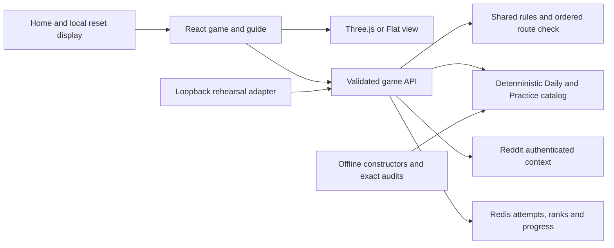

# Architecture

One Small Detour separates pure puzzle logic, platform services and presentation.
The same rules validate local rehearsal, native play and offline content.

## Pure shared core

- [`rules.ts`](src/shared/rules.ts) validates frame shape, non-overlap and fixed
  tiles before returning a new board. Bridge axes constrain connectivity.
- The ordered-route check in [`rules.ts`](src/shared/rules.ts) ensures the
  required home order forms a single non-repeating orthogonal path.
- [`playback.ts`](src/shared/playback.ts) owns courier steps, arrival pauses and
  completion timing. Rendering never decides whether a puzzle is solved.
- [`puzzles.ts`](src/shared/puzzles.ts) exposes safe puzzle/catalog records.
  Authored witnesses stay in server/tooling sources, not the public API.
- [`generation.ts`](src/shared/generation.ts) creates date-seeded Daily layouts.
  Practice has separate generated banks and stable IDs.
- [`progression.ts`](src/shared/progression.ts) derives stars/frontiers while
  preserving older discoveries without inventing results.

Publishing source naturally makes offline witnesses inspectable; this is a
puzzle game, not a cryptographic anti-cheat guarantee. The server still rejects
invalid repairs and untrusted client score/time values.

## Client

[`App.tsx`](src/client/App.tsx) coordinates Home, guide, open puzzle and saved
result states. It keeps the current repair safe when a new edition arrives.

[`BoardView.tsx`](src/client/BoardView.tsx) connects presentation and input.
[`island.ts`](src/client/island.ts) renders the miniature with batched terrain
and the courier rig. Flat mode uses corresponding art while retaining the same
board, frames, routes and progress.

[`useDailyHome.ts`](src/client/useDailyHome.ts) asks for the current account's
authoritative saved result. Other people's ranks do not unlock today's result.
[`usePracticeSync.ts`](src/client/usePracticeSync.ts) handles account generation,
merge/retry behavior and local records safely.

The guide uses [`TutorialCards.tsx`](src/client/TutorialCards.tsx)
after the original hands-on lesson's actual arrivals. It reuses tile artwork,
bridge connectivity and complete frame outlines. Finishing the last card
records the existing three guide flags; closing a partial deck does not.
The earlier lesson fixtures remain available for rule tests and the approved
film, not as the current onboarding sequence. Help presents the explicit replay
action first; opening Help alone does not start an attempt or alter guide flags.

The next-Daily display is a separate
[`NextDailyCountdown.tsx`](src/client/NextDailyCountdown.tsx) component. Its
one-second state updates do not rerender the parent game or touch the 3D board.
It stops intervals while hidden and when unmounted. [`nextDaily.ts`](src/client/nextDaily.ts)
applies the cached server-clock offset and browser-local timezone formatting.
One scheduled boundary wake-up supplements the existing minute/visibility
rollover check; there is no per-second network polling.

## Authoritative API and storage

[`service.ts`](src/server/service.ts) serves bootstrap, places, attempts,
repairs, own results, standings and account-data operations. Inputs and outputs
are guarded by shared contracts.

[`index.ts`](src/server/index.ts) supplies Devvit's Reddit identity and Redis
adapters. Client-submitted user IDs are not native authentication.

Daily start tokens bind an edition/player/version to server time. On completion
the server replays the submitted exchanges and validates the full road.
First-result reservation and retry logic keep the original ranked finish
immutable, even if a later replay is faster. Removing the score leaves the
minimal edition-turn marker needed to prevent another ranked result.

Practice progress is not a leaderboard or secure entitlement. Redis reset
generations prevent stale devices from re-uploading cleared records. Account
and community boundaries are retained on merge.

## Local development and offline work

[`preview.ts`](src/local/preview.ts) is a Vite-only loopback adapter, explicitly
marked Local. Scores/progress under `.local/` are private development data.
Native clients do not send the local identity header.

Content generation runs offline. Older banks and refinements remain immutable
for compatibility and archive replay. Changing an active bank requires replay,
certificate, hash and migration checks, not simply more scramble moves.

The promotional-film composition, private narration credentials, source audio,
render cache and full-frame exports are kept outside this repository. Selected
public gallery images are the only packaging artifacts copied in.

## Four-family Practice construction

[`patchGeneration.ts`](src/shared/patchGeneration.ts) constructs pairs,
three-cell strips, squares and four-cell Ls using the actual legal footprints.
It starts with a solved ordered route, moves complete road parcels into source
stock, and keeps the inverse exchanges as a legal witness. Grass, water and
decorative presentation do not decide difficulty.

[`patchDifficulty.ts`](src/shared/patchDifficulty.ts) separates mathematical
proofs from structural grading:

- Fixed homes/boulders give a geometric lower bound for the ordered journey.
  Road inventory equals that bound, so a successful non-repeating journey must
  use every paving and bridge tile.
- Each exchange imports at most the footprint's area into the union of
  shortest home-leg paths. A witness attaining that bound proves the minimum.
- A preparation step is accepted only when exact source-cover search proves
  the initial stock cannot be partitioned into legal footprints. Full-footprint
  insulation prevents a maximum-import exchange from secretly retiling the
  remaining stock. A witness must attain the resulting one-step larger bound.
- Search-limit exhaustion is a rejection, never a proof of impossibility.
  Witness prefixes and bounded greedy probes must also respect the offline
  route-search budget.

[`campaignCurriculum.ts`](src/shared/campaignCurriculum.ts) defines absolute
campaign stages, rather than restarting difficulty at each 20-stop island.
The accepted chain has nondecreasing move minima, board size, route-choice
pressure and planning grade. Frames are introduced and revisited; later stages
require genuinely proved preparation moves for every family. Both bridge axes
are revisited across each family/stage, not forced onto every individual board.

[`generate-practice-campaign.ts`](tools/generate-practice-campaign.ts) rejects
cheap envelope failures before expensive greedy grading. It selects a globally
ordered, family-balanced chain, rejects normalized duplicates, near-clones and
overused reasoning profiles, and assigns titles/themes only after grading.
Checkpoints are payload-hashed and source-bound; changed sources do not silently
approve earlier proof records. Only a complete 1,000-stop result is written.

[`verify-practice-campaign.ts`](tools/verify-practice-campaign.ts) freshly
replays and regrades the entire bank, checks the global curve and family quotas,
reconstructs representative recipes, and verifies unchanged archived routes.
Generation and audit code are not part of client render or API request paths.

The design draws on [Traynor's puzzle-design strategies](https://cwpat.me/misc/puzzle-level-idea-strategies/),
[Rix's Trainyard teaching presentation](https://media.gdcvault.com/gdc2012/slides/Design%20Track/Rix_Matt_Level_Design_Casestudies.pdf),
[transport-puzzle difficulty research](https://cdn.aaai.org/ocs/2518/2518-11200-1-PB.pdf),
[reasoning/dependency difficulty models](https://arxiv.org/html/1403.7373v1), and
[construct-and-filter Sokoban generation](https://ianparberry.com/pubs/GAMEON-NA_METH_03.pdf).
Applying those ideas here is an engineering inference. Exact inventory/minimum
certificates are proofs; the structural grades are not an empirically calibrated
human-difficulty or enjoyment model. Human playtesting remains necessary.

## Campaign compatibility

Campaign negotiation is separate from Daily rule and score versions. Retain
older catalog responses and original puzzle IDs while archiving every replaced
board in the latest catalog. The canonical Practice store must keep the superset
of all revisions; responses are projected for older clients, but an older
client's merge must not delete newer records.

[`progression.ts`](src/shared/progression.ts) follows original-road references
to preserve earned stars, completion credit and access. Credit is not a claim
that a replacement board was solved. Old move records stay attached to the
old board, and new boards never receive invented bests.

Reset generations remain account/community scoped across campaign versions.
The client retains a separate local generation stamp because an older cached
client can preserve unknown newer IDs while dropping their move records during
a reset. The newer client then lets authoritative account sync reconcile the
reset, rather than silently deleting local records or resurrecting cleared ones.
Migration checks include a frozen previous client earning real local results
before a same-origin upgrade, and an older client saving again after a newer
result exists. Those fixtures do not submit live Daily scores.

## Release boundaries

1. Run the source/type/build and Daily audit gates.
2. Verify responsive behavior and genuine interactions for affected screens.
3. Freeze the tested output, upload an explicit private Devvit version and
   compare delivered assets.
4. Update only the authorized test installation and existing post.
5. Publish source separately after a local staged/history secrets audit.

Do not alter rule/ranking versions, campaign IDs or storage generations for a
presentation-only change. Local browser checks are not a substitute for fresh
Reddit iOS/Android physical-device testing.
