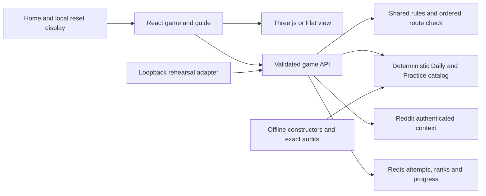

# Architecture

One Small Detour separates pure puzzle logic, platform services and presentation.
The same rules validate local rehearsal, native play and offline content.

## Pure shared core

- [`rules.ts`](src/shared/rules.ts) validates frame shape, non-overlap and fixed
  tiles before returning a new board. Bridge axes constrain connectivity.
- The ordered-route check in [`rules.ts`](src/shared/rules.ts) ensures the
  required home order forms a single non-repeating orthogonal path.
- [`playback.ts`](src/shared/playback.ts) owns courier steps, arrival pauses and
  completion timing. Rendering never decides whether a puzzle is solved.
- [`puzzles.ts`](src/shared/puzzles.ts) exposes safe puzzle/catalog records.
  Authored witnesses stay in server/tooling sources, not the public API.
- [`generation.ts`](src/shared/generation.ts) creates date-seeded Daily layouts.
  Practice has separate generated banks and stable IDs.
- [`progression.ts`](src/shared/progression.ts) derives stars/frontiers while
  preserving older discoveries without inventing results.

Publishing source naturally makes offline witnesses inspectable; this is a
puzzle game, not a cryptographic anti-cheat guarantee. The server still rejects
invalid repairs and untrusted client score/time values.

## Client

[`App.tsx`](src/client/App.tsx) coordinates Home, guide, open puzzle and saved
result states. It keeps the current repair safe when a new edition arrives.

[`BoardView.tsx`](src/client/BoardView.tsx) connects presentation and input.
[`island.ts`](src/client/island.ts) renders the miniature with batched terrain
and the courier rig. Flat mode uses corresponding art while retaining the same
board, frames, routes and progress.

[`useDailyHome.ts`](src/client/useDailyHome.ts) asks for the current account's
authoritative saved result. Other people's ranks do not unlock today's result.
[`usePracticeSync.ts`](src/client/usePracticeSync.ts) handles account generation,
merge/retry behavior and local records safely.

The next-Daily display is a separate
[`NextDailyCountdown.tsx`](src/client/NextDailyCountdown.tsx) component. Its
one-second state updates do not rerender the parent game or touch the 3D board.
It stops intervals while hidden and when unmounted. [`nextDaily.ts`](src/client/nextDaily.ts)
applies the cached server-clock offset and browser-local timezone formatting.
One scheduled boundary wake-up supplements the existing minute/visibility
rollover check; there is no per-second network polling.

## Authoritative API and storage

[`service.ts`](src/server/service.ts) serves bootstrap, places, attempts,
repairs, own results, standings and account-data operations. Inputs and outputs
are guarded by shared contracts.

[`index.ts`](src/server/index.ts) supplies Devvit's Reddit identity and Redis
adapters. Client-submitted user IDs are not native authentication.

Daily start tokens bind an edition/player/version to server time. On completion
the server replays the submitted exchanges and validates the full road.
First-result reservation and retry logic keep the original ranked finish
immutable, even if a later replay is faster. Removing the score leaves the
minimal edition-turn marker needed to prevent another ranked result.

Practice progress is not a leaderboard or secure entitlement. Redis reset
generations prevent stale devices from re-uploading cleared records. Account
and community boundaries are retained on merge.

## Local development and offline work

[`preview.ts`](src/local/preview.ts) is a Vite-only loopback adapter, explicitly
marked Local. Scores/progress under `.local/` are private development data.
Native clients do not send the local identity header.

Content generation runs offline. The installed reasoning bank and its
refinements are verified independently of the pair-only review constructor.
Changing a generated bank requires replay, certificate, hash and migration
checks, not simply more scramble moves.

The promotional-film composition, private narration credentials, source audio,
render cache and full-frame exports are kept outside this repository. Selected
public gallery images are the only packaging artifacts copied in.

## Release boundaries

1. Run the source/type/build and Daily audit gates.
2. Verify responsive behavior and genuine interactions for affected screens.
3. Freeze the tested output, upload an explicit private Devvit version and
   compare delivered assets.
4. Update only the authorized test installation and existing post.
5. Publish source separately after a local staged/history secrets audit.

Do not alter rule/ranking versions, campaign IDs or storage generations for a
presentation-only change. Local browser checks are not a substitute for fresh
Reddit iOS/Android physical-device testing.
