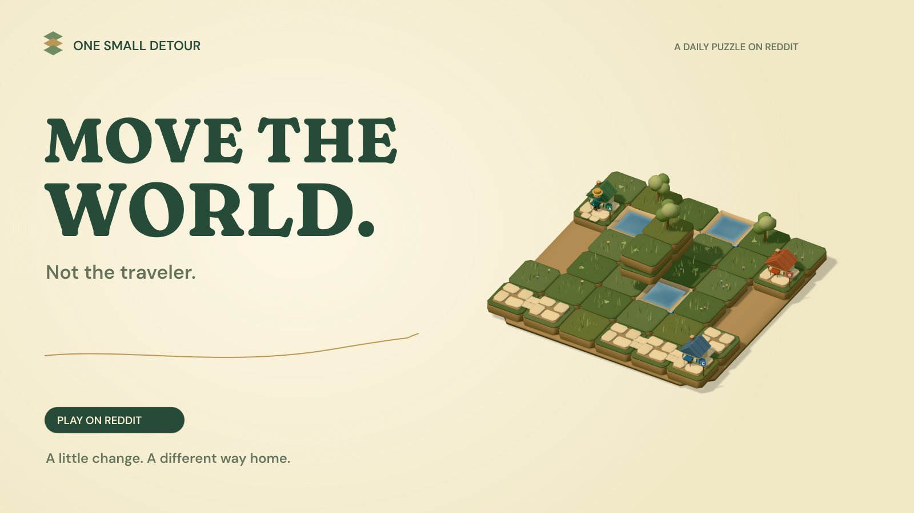

# One Small Detour



**Don't move the traveler. Move a little piece of the world.**

A daily miniature-landscape puzzle built for Reddit. Exchange matching patches
of terrain, connect the homes in order, and watch the courier follow the road
you made.

[Play on Reddit](https://www.reddit.com/r/small_detour_dev/comments/1y6qwml/one_small_detour_a_little_change_a_different_way/) |
[App listing](https://developers.reddit.com/apps/small-detour) |
[Architecture](ARCHITECTURE.md) |
[Submission guide](SUBMIT_STEP_BY_STEP.md)

## The daily loop

- **One shared Daily:** a date-seeded puzzle resets at 00:00 UTC for everyone.
  Home shows the time remaining and the opening time in your local timezone.
  Local display does not change the edition or leaderboard.
- **A fair first finish:** signed-in players' first completed Daily result is
  ranked by fewest exchanges, then server-measured solve time. Replays are
  unranked; removing a result does not give another ranked turn.
- **A little more tomorrow:** seven landscape themes and fresh road layouts
  bring variety to the same understandable rules.
- **An optional inbox reminder:** Home's **Remind me daily** switch is off by
  default. Choose a reminder time in the displayed timezone; unfinished Dailies
  get at most one Reddit inbox message per edition. Phone alerts depend on
  Reddit settings; this is not the gated native push-notifications feature.
- **Keep exploring:** Practice has 1,000 active puzzles across 50 islands,
  with pairs, three-cell strips, 2x2 squares and four-cell Ls. Every road and
  bridge tile is necessary. Proved minima rise from 3 to 8 exchanges without
  island resets; structural planning grades also do not decrease. This is not
  a claim that every successive stop feels harder to every player.
- **Make it comfortable:** 3D/Flat and Light/Dark views, bundled nature audio,
  reduced-motion support, and responsive phone/tablet/desktop layouts.

The game is free. No ads, payments, runtime AI or external analytics are needed.
Daily standings are scoped to the subreddit installation, not all of Reddit.
Guest finishes can be played and kept locally but are not a signed-in Daily rank.

## How to play

1. Read the displayed home order: **A, then B, then C**, and so on.
2. Choose a frame allowed on this island. Select one whole patch, then a
   matching, non-overlapping patch. They exchange immediately.
3. Roads, grass, trees, water, bridges and decorations travel with their patch.
   **Homes and boulders stay fixed.** Terrain never rotates.
4. Build one orthogonal road through the homes in order, without revisiting
   a square. Grass and water cannot carry the courier.
5. Bridges connect along their planks, in both directions. **Ends connect;
   sides do not.** A bridge end can meet a home directly; a bridge cannot turn.
6. The courier waits until the whole road works, then visits every home.

On ordinary boards, arrows mark the left start of a wide patch, the top start
of a tall patch, or the top-left of a square/L. The outline shows the complete
footprint. Tap the selected start again, or press Escape, to deselect.
There is no Undo; every completed exchange counts.

Water squares keep visible individual rims, even beside other water. The same
tile boundaries appear in 3D and Flat; usable bridge ends remain unobstructed.
These separators are visual and do not change road connections or selection.

The tutorial keeps the original untimed, three-swap lesson and
courier journey, then shows six concise illustrated cards: the shown home order,
no repeated road squares, moving/fixed tiles, horizontal bridges, vertical
bridges, and left/top/top-left selection. Correct and incorrect routes contrast
A-B-C with A-C-B and mark a reused road square with `2x`. Grass
and trees share a movable icon. Both bridge cards show a valid end, a blocked
side, and how a home accepts a connection on any side. Tap or click the same
starting tile again to clear the first choice.

Cards advance at the player's pace with Back/Next. The final **Ready to play**
action remembers the guide; closing early does not unlock Daily. Previously
remembered unlocks and earned progress remain valid.
Opening **?** shows a prominent **Replay walkthrough** card first, followed by
the detailed rules and account-data controls. See the
[release status](SUBMISSION.md) for the installed test build.

Choosing Play begins a three-second countdown once the board is ready. The
solve timer stops on the winning exchange, before the courier animation.
Backgrounding does not stop ranked elapsed time. Failed saves have an explicit
retry; an open puzzle is not replaced automatically at Daily rollover.

## Run locally

Requires **Node.js 22.18 or newer** and npm.

```powershell
npm ci
npm run dev
```

Open `http://127.0.0.1:5173/`.

The loopback rehearsal uses the same game API and rules with local storage
adapters. It is labelled Local. Its identity is not Reddit authentication,
and its ranks do not represent community activity.

The lockfile preserves the tested dependency versions. Some existing resolved
URLs use Microsoft's public npm mirror; an external clean install should be
checked from a normal network. This release was built with the installed
locked dependencies. A public-registry probe from the preparation machine
failed at TLS, not at game compilation; no fresh-network success is claimed.

Do not publish the development server or expose `.local/` as an authenticated
service. Local score/progress records, credentials, build output, editor state
and Python caches are excluded from Git.

## Build and verify

```powershell
npm run typecheck
npm test
npm run build
npm run verify:practice
npm run verify:daily
```

Or run the complete gate:

```powershell
npm run check:release
```

The tests cover immutable exchanges, bridge axes, ordered routes, generator
certificates, first-result ranking, save/retry behavior, account isolation,
progress migration, artwork and timer behavior. The Practice audit freshly regrades all 1,000 boards, verifies every necessary
road tile and exact move certificate, checks the global curriculum/diversity
gates, reconstructs 68 representative recipes and replays all 1,448 archives.
The Daily audit samples 365
distinct editions, checks legal witnesses and rejects campaign repeats in
that sample. These are engineering checks, not claims of worldwide novelty,
guaranteed player retention or universal physical-device performance.

The local-time countdown is isolated to Home. It updates once per second only
while visible, uses the cached server-clock offset and makes no polling calls.
Five timezone/layout browser checks verify alignment, phone action visibility,
no added requests during ticks, and correct time after returning Home.

## Reddit installation

The app uses **Devvit Web**, React, Three.js, TypeScript and Redis.
The authorized playtest community is
[r/small_detour_dev](https://www.reddit.com/r/small_detour_dev/).
The existing interactive post is retained; installation updates do not recreate
the campaign or clear earned progress.

The native app requests Reddit and Redis permissions. A moderator-menu action
creates a post only when explicitly invoked. It does not auto-post, use
post-as-user permissions or request external-fetch domains.

The reminder scheduler checks due choices once a minute in bounded batches.
Only explicitly opted-in accounts can receive a message, linking to the
existing interactive post; it does not create another daily post. Completed
or removed Daily turns are skipped. Missed windows are not sent more than an
hour late or carried into another UTC edition. A reservation prevents retries,
time changes and off/on toggles from producing duplicate messages. Failed or
unconfirmed deliveries are reported on Home and in server logs; ambiguous
sends are not automatically repeated.
Opt-out retains a minimal reset generation, so stale or delayed enable requests
cannot turn reminders back on without checking the current choice first.
An unreadable or failed preference request shows **Not confirmed**, never a
false Off state; players can check again or directly turn reminders off.

Local rehearsal saves reminder choices in server memory across page reloads,
not server restarts, and never sends messages or runs the Reddit scheduler.
Deploying the changed app will register the recurring scheduler, but no account
is subscribed automatically. Hosted delivery must still be verified in the
authorized test community before a production release.

App upload/playtest is distinct from broad marketplace publication.
Use the configured test community; do not install into unrelated subreddits.
See [submission/release status](SUBMISSION.md) before updating the playtest.

## Progress and privacy

Signed-in Practice progress is synced to per-account Redis records in the same
installation. Guests keep device-local progress. Original and replaced routes
remain addressable under stable IDs; updates preserve old results without
pretending that new boards were solved.

When an island needs more stars, continuation opens the Practice map so the
player can choose a completed stop to improve. No particular replay is assigned;
ordinary continuation still opens the next new stop when its island is unlocked.

Daily records expire after their retention window. Account data controls
separate Daily records from Practice progress. A minimal used-turn marker
prevents result deletion from granting another ranked turn on the same edition.

Display timezone is read through the browser's `Intl` API. The countdown alone
does not transmit or save it. Opting into reminders saves the chosen time and
timezone solely to schedule inbox messages, never for tracking or separate
local-midnight leaderboards. Read the full [privacy description](PRIVACY.md).

## Repository map

| Area | Responsibility |
|---|---|
| [`src/client/`](src/client/) | Home, tutorial, gameplay, 3D/Flat art, preferences and accessible controls |
| [`src/shared/`](src/shared/) | Rules, Daily generation, Practice catalog, timing and immutable data contracts |
| [`src/server/`](src/server/) | Authoritative validation, Reddit identity, attempts, ranking and Redis progress |
| [`src/local/`](src/local/) | Loopback-only score/progress adapters |
| [`tools/`](tools/) | Offline content construction, certificate audits and art processing |
| [`submission-assets/`](submission-assets/) | Selected presentation images; not player data |

Practice construction and expensive search run **offline**, never in the
client render loop or an API request. The four-family bank contains 295 pair,
271 strip, 234 square and 200 L puzzles; 599 require a proved preparation step.
Earlier banks remain immutable archives. See the
[construction and research notes](ARCHITECTURE.md#four-family-practice-construction)
for the proof boundaries and human-playtesting limitation.

## Film and artwork

The owner-approved **80-second coded 3D trailer** uses actual game assets and
legal examples, with Gemini Puck narration and original synthesized music.
It is a designed promotional film, not unedited native gameplay footage.
Harder examples are labelled as opening moves; their full repairs are
separately validated. No invented players or scores appear.

All 4,800 frames in each 1080p60 export are individually rendered. Every
narration clip's actual placement is checked in both encoded formats.
The event recommends a video under one minute, and judges need not watch
beyond that point; see the [submission guide](SUBMIT_STEP_BY_STEP.md).

## License

Original code is released under [MIT](LICENSE).
The Devvit template retains its BSD-3-Clause notice, fonts use SIL OFL, and
Poly Haven source materials use CC0. Project-authored compositions are not
library preview images or an endorsement by the asset authors.

See [third-party notices](THIRD_PARTY_NOTICES.txt) and the asset-folder license
files. The public source license does not replace those third-party terms.
